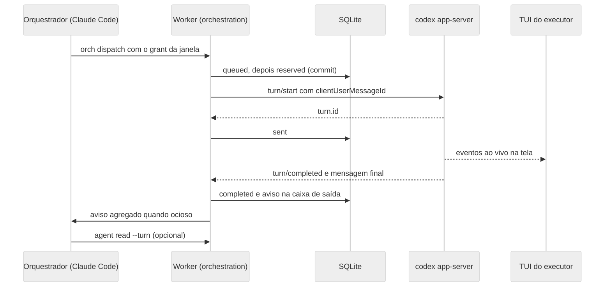

# Adaptadores e ciclo de vida do executor

Esta é uma parte do [ADR da orquestração por serviço de executor](ADR-orchestration-executor-service.md).

## Adaptador Codex app-server

### Processo e transporte

| Item | Regra |
| --- | --- |
| Comando | `codex app-server --listen ws://127.0.0.1:<porta> --ws-auth capability-token --ws-token-sha256 <hex>`, mais `-c 'projects={"<cwd>"={trust_level="trusted"}}'` para o cwd do executor e overrides `-c` de confiança de hooks quando houver (forma de tabela inline, V2 e V3) |
| Porta | `reserveLoopbackPort('127.0.0.1')` pela porta `PortReserver`, com até 3 tentativas em porta nova se o bind falhar |
| Token | 32 bytes aleatórios em base64url por início; a linha de comando leva só o SHA-256, e o texto fica na memória do Worker |
| Cliente | Pacote `ws` (já dependência), com o token no upgrade; Bearer, validado em V1; `--remote-auth-token-env` também funciona na TUI, e `/readyz` fica aberto sem auth |
| Prontidão | `GET /readyz` (aberto, sem auth) até 200, prazo de 10 s, depois `initialize` e `initialized` |
| Ambiente | O do Worker sem variáveis `OPENCOVE_*`, mais as variáveis do provedor nas configurações; `CODEX_HOME` do usuário, sem isolamento |
| Métodos permitidos | Handshake, `thread/*`, `turn/*`, `hooks/list`, `thread/name/set`, `thread/unsubscribe` e `thread/archive` |
| Métodos bloqueados no cliente | `config/value/write`, `config/batchWrite` e `skills/config/write` |
| Socket unix | Adiado; ws em loopback com token cobre Linux, macOS e Windows por um caminho só |

### Sessão e turno do Codex

- `thread/start` leva `cwd`, `sandbox`, `approvalPolicy`, `ephemeral:false`, `model` opcional e `serviceName:"glimpse"`. Em seguida, `thread/name/set` nomeia a thread como "Glimpse: título do nó".
- O `threadId` vira o `sessionRef` gravado na ligação, e o reinício usa `thread/resume`.
- Achado 6: a thread persistente grava em `~/.codex/sessions`, aceito porque o resume depende disso. O nome deixa claro no histórico do usuário o que veio do Glimpse.
- `turn/start` leva `threadId`, `input:[{type:"text", text, text_elements:[]}]` e `clientUserMessageId` igual ao `dispatchId`. A resposta com `turn.id` marca o despacho como `sent`.
- `item/completed` do tipo `agentMessage` guarda o último texto do turno, e `turn/completed` fecha pelo `turn.status`.
- Mapa de status: `completed` vira `completed`, `interrupted` vira `failed(interrupted)` e `failed` vira `failed(turn_failed)`. Depois de queda do serviço, o turno em voo volta `interrupted` (V6), localizado por `clientId`, e o despacho `sent` sem `turn/completed` observado vira `failed(executor_down)`; `failed(interrupted)` fica para a interrupção pedida pelo Glimpse.
- Turno sem `clientUserMessageId` do Glimpse veio da tela. Ele ocupa o executor, a admissão bloqueia novos despachos enquanto durar, e ele não gera aviso.
- Política de sandbox: o executor segue a opção de acesso total das janelas comuns, por decisão do Bruno. Desligada, `workspace-write` com `on-request`; ligada, `danger-full-access` com `never`, e então o executor não pede aprovação e só o alerta de indisponível vale.

### Reconciliação do Codex

- `thread/turns/list` em ordem decrescente, limite 20, procura o `userMessage` com `clientId` igual ao `dispatchId`. O eco desse campo foi confirmado em V4.
- Turno encontrado: o status dele decide o despacho, com `interrupted` depois de queda mapeado para `failed(executor_down)`.
- Ausente, com a lista legível desde `reserved_at`: `failed(not_sent)`, rodada devolvida e aviso ao orquestrador.
- Sem eco do `clientId`, o casamento usa o `turnRef` quando a resposta chegou. Sem resposta, o despacho fica `uncertain` e o aviso pede verificação na tela.

### Aprovações do Codex

- Requests do servidor ficam pendentes, sem recusa automática, e viram `approval.requested`.
- Fecham por `orch.approval.respond` do usuário, por resposta na tela (notificação `serverRequest/resolved`) ou por interrupção do turno.
- Formato da resposta: `{decision}` com `accept`, `acceptForSession`, `decline` ou `cancel`, que recebem 1 para 1 as decisões `approve`, `approve_for_session`, `deny` e `cancel` de `ApprovalDecision` (`cancel` também interrompe o turno); elicitation usa `action`, e permissões devolvem `{permissions, scope}`.
- Request de método desconhecido recebe erro JSON-RPC -32601 e gera `executor.degraded`, para o serviço nunca travar esperando.
- Com dois clientes conectados (Glimpse e TUI), os dois recebem o request (V5). Quem responder primeiro fecha, e o outro limpa pelo `serverRequest/resolved`.

### Confiança de pasta e de hooks

| Portão | Onde aparece | Resposta do Glimpse | Gravação |
| --- | --- | --- | --- |
| Pasta (portão 1) | TUI cliente, decidido pelo servidor | `-c 'projects={"<cwd>"={trust_level="trusted"}}'` na linha do `app-server`, para o cwd exato do executor | Nenhuma em `~/.codex` |
| Hooks (portão 2) | `hooks/list` do serviço e TUI | O serviço lê o `~/.codex` real e herda a confiança que o usuário já deu; pendentes viram aviso e podem ser aprovados no Glimpse | Nenhuma em `~/.codex`; aprovação em tabela do Worker |

A viabilidade V2 foi negativa para a TUI: com `--remote`, o portão é decidido pela configuração do servidor, e nem o `-c` da TUI nem um `CODEX_HOME` próprio dela o removem. A forma pontilhada `projects."<cwd>".trust_level` também não funciona, nem no servidor. A confiança entra só como tabela inline no processo do servidor do Glimpse, vale apenas para o cwd do executor e não grava em `~/.codex`. A TUI do executor não leva `-c` de confiança nem `CODEX_HOME` próprio.

A causa provável dos hooks `untrusted` na prova é a limpeza legada, que apagava a confiança a cada abertura e que a fase 0 corrige neste ramo. O fluxo do executor fica assim:

1. No início do serviço, `hooks/list {cwds:[cwd]}`.
2. Hook `trusted` ou `managed` não pede nada.
3. Hook `untrusted` ou `modified` com aprovação no Glimpse para o mesmo par (`key`, `currentHash`) entra como override por chave, `-c 'hooks.state={"<key>"={trusted_hash="<hash>"}}'`, no próximo início do serviço. Com o executor ocioso, o Worker reinicia o serviço na hora e retoma a thread.
4. Sem aprovação, o hook não roda. `orch status` e a interface mostram quantos hooks do usuário aguardam confiança, e nada é aprovado sozinho.
5. Hash diferente invalida a aprovação. A aprovação é global e vale para o par (`key`, `currentHash`) em qualquer executor, gravada com `eventName`, `sourcePath` e `approvedBy`. Não há revogação nesta fase, e fechar um vínculo não apaga a aprovação.

V3 foi parcial: a forma pontilhada `hooks.state."<key>".trusted_hash` é ignorada, e só a tabela inline funciona. A tabela via `-c` mescla com o `config.toml`, então a confiança do usuário se mantém e o resolvedor da janela comum não precisa mudar.

Critério de aceite do achado 2: com `CODEX_HOME` temporário e um hook `PreToolUse` do usuário que grava um marcador, o modelo falso pede a ferramenta de shell. Com confiança na config ou aprovação no Glimpse, o marcador aparece e chega `hook/completed` com `eventName` `preToolUse`. Sem confiança, o marcador não aparece e `orch status` lista o hook.

### Subconjunto do protocolo

- O extrator `scripts/codex-protocol/extract-subset.mjs` roda `codex app-server generate-json-schema --out <tmp>` e guarda só as definições alcançáveis a partir dos métodos usados.
- Ficam versionados em `src/contexts/orchestration/infrastructure/codex/protocol/`: `codex-protocol.subset.json`, `manifest.json` (versão do Codex, métodos e hash por definição) e `codexProtocol.ts` (zod `looseObject` só dos campos lidos).
- `looseObject` tolera campo novo. Campo lido que some ou muda de tipo quebra o teste.
- O teste offline roda sempre, com os esquemas zod contra mensagens gravadas e o manifesto coerente.
- O teste opt-in com `OPENCOVE_TEST_REAL_CODEX=1` regenera o subconjunto pela versão instalada e falha com diff legível se divergir.
- `probe()` exige a versão mínima 0.167.0. Versão maior que a do manifesto roda com aviso de "não validada" até o teste opt-in passar nela.
- A pasta de spikes, com os 4,6 MB, fica ignorada pelo git, e só o relatório da prova vai para `docs/research/` (card F2-00).

## Adaptador opencode v2

Entra na fase 3, com a mesma topologia do Codex: um `opencode serve` por executor, TUI conectada a ele e serviço de fundo do usuário intocado.

### Executável e configuração do opencode

Hoje o `opencode2` do Bruno é uma função do zsh que define `OPENCODE_CONFIG_DIR=~/.config/opencode2`, e o Electron não enxerga funções do shell. O Bruno decidiu limpar o ambiente antes do OC-00: fica só a v2, no caminho padrão do instalador, chamada como `opencode` e com a configuração em `~/.config/opencode`. Com isso, o Glimpse chama `opencode` pelo PATH, como já faz, sem configuração extra.

- Em outros ambientes, o executor continua aceitando o executável de `agentExecutablePathOverrideByProvider.opencode` e as variáveis de `agentEnvByProvider.opencode`, que já existem nas configurações.
- A compatibilidade é decidida pela API: depois do boot, `GET /api/info` com Basic precisa devolver JSON. HTML ou 404 viram `executor.protocol_mismatch` com a mensagem "opencode sem API v2".
- A string de versão não basta, porque com mais de um opencode instalado a ordem do PATH decide qual roda. O status mostra o caminho resolvido e a versão.

### Processo e turnos do opencode

| Passo | Chamada |
| --- | --- |
| Processo | `opencode serve --hostname 127.0.0.1 --port <porta>` no cwd do executor, com `OPENCODE_SERVER_PASSWORD` gerado (V7); V7 confirmou a variável; logo após subir o serviço responde 503 `service_starting`, e o cliente tenta de novo |
| Sessão | `POST /api/session` com `title`, `location.directory` e `model {providerID, id}` |
| Turno | `POST /api/session/{id}/prompt` com `{text}`, sem `delivery` |
| Eventos | `GET /api/event` filtrado pela sessão: `session.execution.started` vira `turn.started`; `succeeded`, `failed` e `interrupted` viram `turn.completed` |
| Mensagem final | `GET /api/session/{id}/message?order=desc&limit=5`, último item `assistant` |
| Aprovações | `GET /api/session/{id}/permission` e `POST .../permission/{requestID}/reply`; formulários em `.../form` |
| Interrupção | `POST /api/session/{id}/interrupt` |
| Reconciliação | O prompt aceita `id` (`^msg_`) idempotente (V8): o Worker deriva o id da mensagem do `dispatchId`, e a reconciliação busca a mensagem por esse id, sem digest |
| TUI | `opencode --server http://127.0.0.1:<porta> --session <id> <cwd>`, com a senha e as variáveis do provedor no ambiente |

### Reuso de sessão

- Regra: uma sessão por ligação, usada em todas as rodadas (uma inicial e duas correções). A correção precisa do histórico, então sessão nova por despacho pioraria custo e resultado.
- Sessão nova só em: `orch spawn`, `orch dispatch --fresh` (fase 3), troca de modelo, sessão perdida no resume e uso de contexto acima de 80% da janela quando o serviço informar.
- O cache write de cerca de 17,6 mil tokens volta em qualquer falta de cache, inclusive no turno que chega depois do TTL do provedor. O reuso evita pagar esse custo a cada despacho, sem garantia de eliminá-lo.
- O e2e mede uma segunda sessão no mesmo diretório dentro do TTL (V13, medido com deepseek/deepseek-flash: a segunda sessão saiu cerca de 20 vezes mais barata pelo cache automático, então reabrir quase não custa, e a política de uma sessão por ligação continua por proteger provedores com escrita de cache cara) para calibrar a regra. A mesma regra vale para a thread do Codex.

## Correção mínima do opencode na janela comum

Trilha própria, fora da orquestração, porque afeta quem abre o opencode v2 no canvas hoje. A viabilidade OC-00 decidiu pela forma com `serve` separado (V10 negativo: o raiz rejeita `--hostname`, `--port` e `--model`).

| Parte | Hoje | Correção mínima |
| --- | --- | --- |
| Lançamento | `opencode --hostname --port`, com `--model` e `--session` ou `--prompt` | O Worker sobe `opencode serve --hostname 127.0.0.1 --port 
` supervisionado, e a TUI entra por `opencode --server <url> --session <id>` |
| Versão | Um caminho só | Detecção por `--version` no lançamento, com o caminho da v1 preservado como está |
| Autenticação | Nenhuma | Basic `opencode:<senha>`, com senha por lançamento |
| Descoberta e status | `GET /session?directory=` e `GET /session/status?directory=` | Endpoints `/api/*` equivalentes, mapeados no OpenAPI da versão instalada |
| Formato | `.json()` sobre resposta HTML lança erro | Conferir `content-type` JSON; HTML vira `incompatible_api` com diagnóstico |
| Watcher | Um erro para a consulta para sempre | Continua com recuo de 1 s a 30 s e marca estado degradado |
| Modelo | `--model` no raiz | Modelo no `POST /api/session`, não na linha do comando |

## Fallback por terminal como evolução

Fica fora da fase 2 por decisão do Bruno. Na fase 2, `executor.start_failed` e `executor.protocol_mismatch` geram aviso ao orquestrador e alerta ao usuário, como qualquer falha. O desenho abaixo fica registrado para quando voltar.

- Entraria quando o provedor não tem serviço, quando `executor.start_failed` esgota os reinícios ou quando há `executor.protocol_mismatch`, atrás de uma configuração própria.
- Mecânica: janela Codex gerenciada comum, com os hooks e o resolvedor de confiança atuais. O primeiro despacho vai como prompt de lançamento, e os seguintes por `PromptDeliveryService` com `deliveryId` igual ao `dispatchId` e `whenBusy: 'refuse'`.
- O fim do turno vem do Stop do hook, e a mensagem final de `agent.finalMessage`.
- Limites: a reconciliação é por inferência, porque `PromptDeliveryService` marca incerto e nunca reenvia. A ligação ficaria com `runtime_mode: terminal`, visível no status e na seta pontilhada.

## Ciclo de vida do serviço por executor

| Aspecto | Regra |
| --- | --- |
| Quem sobe | O Worker, por `orch.spawn`, pela reconciliação do boot ou, na fase 3, pela conexão confirmada a uma sessão já aberta |
| Supervisão | `ExecutorProcessSupervisor` no Worker cuida de início, saída, saúde, reinício e degradação, conforme a regra de processo hospedeiro do `AGENTS.md` |
| Endereço | Loopback 127.0.0.1 com porta reservada a cada início, ws no Codex e HTTP no opencode |
| Credencial | Token de capacidade (Codex) ou senha (opencode) por início, só em memória, trocados a cada reinício |
| Prontidão | `/readyz` no Codex ou `/api/info` no opencode, em até 10 s |
| Saúde | A saída do processo é a fonte principal; ping do ws a cada 15 s, e duas falhas seguidas viram `degraded` |
| Reinício | Recuo de 1, 2 e 4 s, no máximo 3 em 60 s; depois `unavailable`, com a ligação ainda ativa e aviso ao orquestrador |
| Morte durante turno | O despacho em voo vira `uncertain`, e a reconciliação depois do reinício decide |
| Reconexão do adaptador | ws caído com processo vivo reconecta com o mesmo token até 3 vezes antes de virar queda |
| Reconexão da TUI | O serviço novo tem porta e token novos; o Glimpse encerra a TUI antiga e relança `codex resume <threadId> --remote ...` no mesmo nó |
| Âncora do run state | A sessão de PTY da TUI; sem tela viva, o Worker relança a TUI antes do próximo despacho e a reconciliação completa o arquivo de turnos |
| Encerramento | `orch close`, exclusão do nó ou saída do app: `turn/interrupt` se houver turno, depois SIGTERM, 3 s e SIGKILL no grupo de processos (V9: o SIGTERM não encerra o servidor com turno em voo). Em `orch close` e na exclusão do nó, `thread/archive` vem antes do SIGTERM; na saída do app, a ligação segue ativa e a thread é retomada no boot |
| Reinício do Worker | O órfão é identificado pelo pid gravado e pelo hash do token na linha de comando, e encerrado; o serviço novo retoma a thread antes de qualquer despacho `queued` ser enviado |
| Primeira inicialização | Partida simultânea sobre `CODEX_HOME` vazio falha (V14); o Worker serializa o início dos serviços, sempre no primeiro uso. Sobre home já inicializado, a partida simultânea funciona |
| Retomada da thread | `thread/resume` da mesma thread em dois servidores é recusado (`already has an active writer`), então o serviço antigo morre antes de o novo retomar |
| Memória | 92 a 119 MiB ocioso e 156 a 188 MiB em turno por app-server (M1), base do teto de 8 executores |
| Limites | Até 4 executores ativos por orquestrador e 8 no total (proposta) |

Reaproveitar o serviço órfão exigiria guardar o token em disco, o que foi descartado. O custo é perder o turno em curso quando o Worker cai, sem duplicar despacho, que é o critério do plano.

