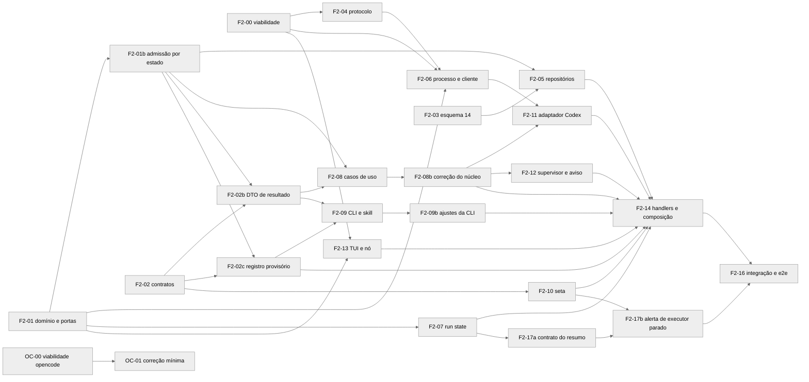

# Partição da fase 2 da orquestração

Cards pequenos para entregar a fase 2 do [ADR da orquestração](ADR-orchestration-executor-service.md) ([adaptadores](ADR-orchestration-executor-adapters.md) e [despacho e superfície](ADR-orchestration-dispatch-and-surface.md)), com o Codex como executor. Cada arquivo tem um card dono por vez, e dois cards ativos ao mesmo tempo nunca tocam o mesmo arquivo. Os testes citados por id (U, C, I, E) estão em [Riscos e testes](ORCHESTRATION_RISKS_AND_TESTS.md).

Os cards das ondas 0 e 1 estão em [ondas 0 e 1](ORCHESTRATION_PHASE2_CARDS_WAVES_0_1.md), os da onda 3 em [onda 3](ORCHESTRATION_PHASE2_CARDS_WAVE_3.md) e o F2-14 em [onda 4](ORCHESTRATION_PHASE2_CARDS_WAVE_4.md).

Critério de aceite da fase, vindo do plano: o Claude Code cria dois executores Codex, despacha, recebe um aviso agregado, lê o resultado e encerra, sem clique. Reiniciar o Glimpse no meio não duplica despacho, e executor morto vira aviso de falha.

## Regras de execução

- TDD em todo card, com `pnpm build:cli` antes do vitest quando o card toca CLI ou contratos.
- `pnpm arch:test` em todo card e `pnpm verify:quick` antes de cada commit, conforme o `AGENTS.md`.
- Revisão por agente diferente do autor, com o critério fechado do plano: perda ou duplicação de despacho, autorização furável entre nós, configuração do usuário alterada e teste obrigatório falhando.
- Card que muda contrato atualiza o documento do contrato no mesmo diff.
- Mudança em porta de `application/ports/` depois da onda 1 passa pelo arquiteto antes do diff. O F2-01b aplica só as mudanças aprovadas na revisão de 09/11/2026.
- Nenhum card abre o app de desenvolvimento; o e2e roda pelo Playwright.
- Custo com modelo pago: o V13 do OC-00 e o E-04 foram autorizados pelo Bruno em 09/11/2026, uma rodada de cada.

## Ondas

| Onda | Cards | Começa quando |
| --- | --- | --- |
| 0 | F2-00 e OC-00 | Já, em paralelo; o OC-00 espera a limpeza do opencode na máquina do Bruno |
| 1 | F2-01, F2-02, F2-03 e F2-04 | Commitada como aprovada em 09/11/2026 |
| 2 | F2-01b, depois F2-02b e F2-02c, depois F2-05 a F2-10 | F2-01b abre a onda; cada card espera suas dependências |
| 3 | F2-08b, F2-09b, F2-11, F2-12, F2-13, F2-17a e F2-17b | F2-08b etapa 1, F2-09b, F2-13 e F2-17a abrem em paralelo; F2-11 e F2-08b etapa 2 abrem depois da etapa 1; F2-17b depois do F2-17a; F2-12 depois do F2-08b inteiro |
| 4 | F2-14 | Ondas 2 e 3 integradas |
| 5 | F2-16 | F2-14 e F2-17b integrados |
| 6 | R1 a R6b | Correções de continuidade da onda 5, antes da fase 3 |
| Trilha OC | OC-01 | OC-00 entregue; cabe na onda 2 ou 3, sem arquivo em comum com elas |

Ordem da onda 2: o F2-01b vai primeiro. O F2-02b e o F2-02c vêm depois dele e rodam em paralelo, porque os arquivos são disjuntos. Os cards F2-05 a F2-10 seguem, cada um depois das suas dependências.

## Onda 2

### F2-01b Admissão por estado (ajuste da onda 1)

| Campo | Valor |
| --- | --- |
| Objetivo | Trocar a deduplicação por conteúdo e a fila FIFO pela admissão por estado: função pura `evaluateDispatchAdmission`, índice único com `queued` e portas ajustadas |
| Papel | dev-backend |
| Depende de | F2-01, F2-02 e F2-03 (onda 1 commitada); abre a onda 2 |
| Arquivos donos | `src/contexts/orchestration/domain/dispatch.ts` e `dispatchAdmission.ts` (novo, porque `dispatch.ts` tem 296 linhas); `src/contexts/orchestration/application/ports/repositories.ts` e `hostPorts.ts`; `src/platform/persistence/sqlite/orchestrationTables.ts` e `schema.ts`; `src/shared/contracts/controlSurface/operations/domains/orch.ts`; `src/shared/errors/appError.ts`; `docs/architecture/PERSISTENCE.md`; `tests/unit/contexts/orchestration/domain/dispatchAdmission.spec.ts` (novo) e `dispatch.spec.ts`; `tests/contract/platform/persistenceStore.orchestrationSchema.spec.ts`; `tests/contract/controlSurface/orch.contract.spec.ts` |

Aceite verificável:

- U-12 verde: uma tabela de casos por linha da tabela "Admissão por estado" do ADR de despacho, na ordem de precedência, e a função não recebe relógio nem texto.
- `dispatch.ts` perde `CONTENT_DEDUPE_WINDOW_MS`, `allowRepeat` e `now` da identidade; `classifyDispatchRequest` fica só com D5 (mesmo `dispatchId` e mesmo payload dá `duplicate`, payload diferente dá conflito). Nenhum arquivo passa de 300 linhas nem função de complexidade 10.
- Portas, só estas mudanças: `DispatchRepository.findNonFinalByExecutor` no lugar de `listRecentNonFinalByHash`; `InsertDispatchResult` ganha `executor_busy`; `OrchestratorReadinessPort.watchReadiness(orchestratorNodeId, listener)` devolve cancelador. `findInFlightByExecutor` e `findOldestQueuedByExecutor` ficam, com o comentário "FIFO" corrigido.
- C-01 verde: o índice passa a `orchestration_dispatches_open_executor_unique_idx` com `queued`, o nome antigo recebe `DROP INDEX IF EXISTS`, e banco 14 de desenvolvimento com o índice antigo é reparado na abertura. A chave drizzle vira `openExecutorIdx`.
- `allowRepeat` sai de `orch.ts`; o `strictObject` o recusa (teste em `orch.contract.spec.ts`), e o summary de `orch.status` cita admissão em vez de fila.
- A mensagem de `orch.dispatch_in_flight` em `appError.ts` deixa de falar em `force` para o despacho e descreve a recusa por despacho em aberto.
- `PERSISTENCE.md` cita o índice único com `queued`.
- `dispatch.ts` ganha a transição `queued` para `failed(not_sent)` (executor indisponível), com teste em `dispatch.spec.ts`; como `dispatch.ts` não pode passar de 300 linhas, a regra nova entra com o mínimo de código ou em módulo vizinho.
- `pnpm exec vitest run tests/unit/contexts/orchestration tests/contract/platform tests/contract/controlSurface`, `pnpm arch:test` e `node harness/architecture/check.mjs --mode audit` sem arquivo novo nos resultados.

### F2-02b DTO de resultado do despacho

| Campo | Valor |
| --- | --- |
| Objetivo | Fixar em zod os resultados de `orch.dispatch`, `orch.status` e `orch.spawn`, com `admission`, o bloqueante e os quatro motivos de falha |
| Papel | dev-backend |
| Depende de | F2-01b |
| Arquivos donos | `src/shared/contracts/dto/orchestration.ts`; `src/shared/contracts/dto/index.ts` se reexportar; `tests/contract/controlSurface/orch.results.contract.spec.ts` (novo) |

Aceite verificável:

- Os esquemas seguem a seção "Resultados de orch.dispatch, orch.status e orch.spawn" do ADR, todos em `z.strictObject`, sem decisão nova: `dispatchFailureReason`, `dispatchOutcome`, `admissionReason`, `blockingDispatch`, `admission`, `dispatchAccepted`, `dispatchView` e os três resultados.
- Os refinamentos valem em teste: `blocking` só existe com `reason = dispatch_in_flight`; `willWait` só com `canDispatch` verdadeiro; `reason` de `dispatchView` só com `state = failed`; resultado sem `queuePosition` é recusado.
- C-02 verde na parte de resultado, e `pnpm build:cli` passa.
- Nenhum arquivo de `orch.ts`, do registry ou de handler muda.

### F2-02c Registro provisório das doze operações

| Campo | Valor |
| --- | --- |
| Objetivo | Registrar as doze `orch.*` no `registry.ts` com um handler provisório que recusa sempre, para o F2-09 compilar `defineCommand({ operation: 'orch.dispatch' })` |
| Papel | dev-backend |
| Depende de | F2-01b (`allowRepeat` já fora); paralelo ao F2-02b |
| Arquivos donos | `src/shared/contracts/controlSurface/operations/registry.ts`; `src/app/main/controlSurface/registerControlSurfaceHandlers.ts`; `src/app/main/controlSurface/handlers/orchestrationProvisionalHandlers.ts` (novo); `tests/unit/contexts/controlSurface.operations.spec.ts`; `tests/unit/app/__snapshots__/cliInputOutput.spec.ts.snap` |

Aceite verificável:

- `registry.ts` importa e espalha `orchOperations`, e `controlSurface.operations.spec.ts` passa a esperar 162 operações `schema` (eram 150).
- O handler provisório recusa as doze com `common.unavailable` (já existe em `dto/error.ts` e `appError.ts`). Esse código serve às doze, mesmo às que não listam `orch.executor_unavailable`, e não leva o orquestrador a achar que o executor caiu.
- `operationRegistry.spec.ts`, `controlSurface.introspection.spec.ts`, `controlSurface.operationSummaries.spec.ts` e `sessionGrants.spec.ts` verdes sem edição; a varredura de JSON schema de `controlSurface.operations.spec.ts` passa. Se algum desses falhar por `orch.ts`, este card assume o ajuste de `orch.ts`, depois do F2-01b.
- O snapshot da CLI reflete o novo tamanho do catálogo, e o F2-09 o herda.
- `CONTROL_SURFACE.md` não muda aqui: continua do F2-14, e nenhum teste o compara com o registry.
- `pnpm build:cli`, `pnpm arch:test` e as pastas `tests/unit/contexts`, `tests/unit/app` e `tests/contract/controlSurface` verdes.

### F2-05 Repositórios SQLite

| Campo | Valor |
| --- | --- |
| Objetivo | Implementar as portas de persistência sobre as tabelas do esquema 14 |
| Papel | dev-backend |
| Depende de | F2-01, F2-03 e F2-01b |
| Arquivos donos | `src/contexts/orchestration/infrastructure/persistence/SqliteAgentLinkRepository.ts`, `SqliteDispatchRepository.ts`, `SqliteNoticeOutboxRepository.ts` e `SqliteHookApprovalRepository.ts`; `tests/integration/orchestration/persistence/*.spec.ts` |

Aceite verificável, em SQLite real temporário:

- CAS com `revision` velha devolve conflito sem gravar.
- A reserva está visível para uma segunda conexão quando a chamada retorna (commit antes do envio, D2).
- `dedupe_key` repetida não cria segundo aviso.
- `orchestration_links_revision` sobe na mesma transação da mudança de ligação.
- I-08 verde: o segundo despacho fora de estado final no mesmo executor, `queued` incluído, devolve `executor_busy` sem gravar; `findNonFinalByExecutor` devolve o único em aberto.

### F2-06 Processo e cliente JSON-RPC do Codex

| Campo | Valor |
| --- | --- |
| Objetivo | Subir e supervisionar o `codex app-server` por executor e falar JSON-RPC com ele |
| Papel | dev-backend |
| Depende de | F2-00, F2-01 e F2-04 |
| Arquivos donos | `src/contexts/orchestration/infrastructure/codex/CodexAppServerProcess.ts`, `CodexJsonRpcClient.ts` e `codexProcessEnv.ts`; `src/contexts/orchestration/infrastructure/process/ExecutorProcessSupervisor.ts`; `tests/unit/contexts/orchestration/codex/CodexAppServerProcess.spec.ts`, `CodexJsonRpcClient.spec.ts` e `tests/unit/contexts/orchestration/process/ExecutorProcessSupervisor.spec.ts`; `tests/integration/orchestration/codexAppServer.real.spec.ts` (opt-in) |

Aceite verificável:

- U-07 e U-08 verdes.
- A linha do `app-server` leva `-c 'projects={"<cwd>"={trust_level="trusted"}}'` (forma de tabela inline, V2) e, para hooks aprovados, `hooks.state={"<key>"={trusted_hash=...}}` (V3); o Worker serializa o início dos serviços (V14) e encerra por SIGKILL no grupo após o prazo (V9).
- Com relógio falso, o supervisor reinicia em 1, 2 e 4 s e para no terceiro reinício dentro de 60 s.
- No teste opt-in com `CODEX_HOME` temporário, `/readyz` responde 200, `initialize` passa e conexão sem token é recusada.

### F2-07 Run state do executor

| Campo | Valor |
| --- | --- |
| Objetivo | Criar a fonte `executor_service` no run state e o ingresso que transforma eventos do executor em estado e arquivo de turnos |
| Papel | dev-backend |
| Depende de | F2-01 |
| Arquivos donos | `src/shared/contracts/dto/terminal.ts`; `src/contexts/agent/domain/agentRunState.ts` e `agentRunStateArbiter.ts`; `src/contexts/agent/application/AgentRunStateRegistry.ts`; `src/contexts/agent/application/AgentTurnHistory.ts` e `src/shared/contracts/dto/agentRunStateSchema.ts` (escopo estendido na onda 2; nenhum outro card os possui); `src/app/renderer/shell/utils/agentRunStateArbiterOwner.ts`; `src/app/main/controlSurface/orchestration/executorRunStateIngress.ts`; `docs/agent/RUN_STATE.md`; `tests/unit/contexts/agent/agentRunState.executorService.spec.ts` |

Aceite verificável:

- Início, aprovação e fim levam o registro de trabalhando para aguardando e depois ocioso, com a fonte nova e as invariantes I1 a I3 intactas.
- A mensagem final de até 64 KiB vai ao arquivo, e `agent read --turn` a devolve.
- Renovação a cada 60 s mantém o lease de 180 s, e sem renovação o estado cai como o árbitro define.
- A suíte atual de run state segue verde.

### F2-08 Casos de uso e despacho

| Campo | Valor |
| --- | --- |
| Objetivo | Implementar spawn, dispatch com admissão por estado, cancel, interrupt, close, extensão, status, aprovações, aprovação de hooks, bomba do despacho, saúde do executor e reconciliação do boot |
| Papel | dev-backend |
| Depende de | F2-01, F2-01b e F2-02b |
| Arquivos donos | `src/contexts/orchestration/application/OrchestrationService.ts`, `spawnExecutor.ts`, `dispatchToExecutor.ts`, `dispatchPump.ts`, `reconcileOnBoot.ts`, `linkLifecycle.ts`, `approvals.ts`, `hookApprovals.ts`, `statusView.ts` e `executorHealth.ts` (novo); `tests/unit/contexts/orchestration/application/*.spec.ts`, exceto os do F2-12, inclusive `executorHealth.spec.ts` |

Aceite verificável, com repositórios em memória e runtime falso:

- U-02, U-03 e U-09 verdes.
- `dispatchToExecutor` chama `evaluateDispatchAdmission` antes de `createDispatch`; a recusa não grava nada nem consome rodada. `classifyDispatchRequest` entra só para D5. O sha256 do texto é calculado na aplicação e passado a `createDispatch` e a `classifyDispatchRequest` (o domínio não importa `node:crypto`), com teste de que o hash confere com o texto.
- `statusView` monta `admission` e `current` e `last` pela mesma função e pelos esquemas do F2-02b, e o status nunca diverge da decisão do despacho.
- A resposta de `orch.dispatch` traz `admission` calculada depois do aceite, com o próprio despacho como bloqueante.
- `executorHealth.ts` implementa a tabela de saúde do ADR, com precedência `unavailable`, `starting`, `degraded`, `busy` e `ready`; o teste cobre cada evento (`executor.ready`, `turn.started`, `turn.completed`, `executor.degraded`, `executor.down` com e sem reinício, `executor.recovered`) e a ordem inversa de `ready` e `recovered`.
- `orch.spawn` repetido com o mesmo `requestId` devolve a ligação existente com `duplicate:true`, e o despacho inicial usa `dispatchId` uuid v5 derivado de `orchestratorNodeId:requestId` (U-02).
- A matriz de reconciliação cobre cada estado em voo contra cada resposta (`found`, `absent` e `unknown`).
- Turno vindo da tela segura o despacho `queued`, e nunca há dois despachos fora de estado final no mesmo executor.
- A rodada volta em `not_sent` e em `cancelled`.
- Gatilho "saúde `unavailable` com `queued`" na bomba ou em `executorHealth`: o despacho `queued` vira `failed(not_sent)`, a rodada volta, o aviso sai com `d=` e a admissão deixa de bloquear; teste em `dispatchPump.spec.ts` ou `executorHealth.spec.ts` com executor indo a `unavailable`.
- Quando o despacho falha com `executor_down`, o fim de turno é emitido ao `ExecutorRunStateIngress` (ou `close()`); sem isso o run state ficaria trabalhando até o lease cair em `unknown`. Teste com repositórios em memória.

Correções posteriores no F2-08b, ver [F2-08b](ORCHESTRATION_PHASE2_CARDS_WAVE_3.md#f2-08b-correção-holística-do-núcleo).

### F2-09 CLI orch e skill

| Campo | Valor |
| --- | --- |
| Objetivo | Criar o grupo `opencove orch` e a seção de orquestração da skill |
| Papel | dev-backend |
| Depende de | F2-02b e F2-02c |
| Arquivos donos | `src/app/cli/commands/orch.ts`, `src/app/cli/commands/index.ts`, `src/app/cli/skill/SKILL.md`, `tests/unit/app/cliOrch.spec.ts` e `tests/unit/app/__snapshots__/cliInputOutput.spec.ts.snap` (passa do F2-02c ao F2-09 em sequência) |

Aceite verificável, depois de `pnpm build:cli`:

- Ajuda de cada subcomando, com `--text` e `--file` exclusivos. `--allow-repeat` não existe, e `--id` aceita o `dispatchId` explícito.
- A CLI imprime o `dispatchId` antes de chamar o Worker (teste de ordem com servidor falso). Nova tentativa de transporte reaproveita o mesmo `dispatchId`, e o servidor falso conta um aceite só.
- Saída do despacho aceito diz "aguarde o aviso" e a posição de fila não existe; recusa `orch.dispatch_in_flight` imprime o despacho bloqueante e sai com 1; `orch status` mostra `admissao=` no lugar de `fila=`.
- Saídas e códigos de saída iguais às tabelas do ADR, inclusive 124 depois de timeout.
- Seção da skill com no máximo 30 linhas, com as instruções de admissão, de timeout e de correção em dois passos.

### F2-10 Seta de ligação no canvas

| Campo | Valor |
| --- | --- |
| Objetivo | Desenhar a seta do orquestrador para cada executor ligado, animada enquanto ele trabalha |
| Papel | dev-frontend |
| Depende de | F2-02 |
| Arquivos donos | `src/contexts/workspace/presentation/renderer/components/workspaceCanvas/hooks/useTaskAgentEdges.ts` e `useCanvasViewModel.ts`; `src/app/renderer/shell/hooks/useWorkerSyncStateUpdates.ts`; `src/contexts/orchestration/presentation/renderer/useOrchestrationLinks.ts` e `orchestrationLinksStore.ts`; `src/app/renderer/styles/workspace-canvas.css`; `src/app/renderer/i18n/locales/en.orchestration.ts`, `zh-CN.orchestration.ts`, `en.ts`, `zh-CN.ts` e `schema.ts`; `tests/unit/contexts/workspace/useTaskAgentEdges.links.spec.ts` e `tests/unit/contexts/orchestration/orchestrationLinksStore.spec.ts` |

Aceite verificável:

- U-10 verde.
- A loja lê as ligações do espelho no estado sincronizado e o reaplica no evento e no `resync_required`, com cliente falso; o hook só desenha, e a autorização nunca o consulta.
- O CSS novo usa só valores da paleta já presentes na seta tarefa-agente.
- Nenhuma seta de ligação é selecionável nesta fase.

## Onda 3

Os cards F2-08b, F2-09b, F2-11, F2-12, F2-13, F2-17a e F2-17b, com a ordem de execução da onda, estão em [onda 3](ORCHESTRATION_PHASE2_CARDS_WAVE_3.md).

## Onda 4

O F2-14, partido em etapas (1, 2, 2b, 3, 4r, 4s, 4a, 4b1, 4b2, 4c, 4d, 5 e 5b) e com a ordem de execução da onda, está em [onda 4](ORCHESTRATION_PHASE2_CARDS_WAVE_4.md). O aceite verificável foi movido por etapa para esse arquivo.

## Onda 5

O bloco de correções do teste manual de 11/11/2026, o card de segurança, o smoke Electron e o ajuste do F2-16 pela Q2 estão em [onda 5](ORCHESTRATION_PHASE2_CARDS_WAVE_5.md).

### F2-16 Integração ponta a ponta e e2e real

| Campo | Valor |
| --- | --- |
| Objetivo | Provar o critério da fase com CLIs reais, reinício do Worker no meio do despacho, morte do serviço e reenvio depois de timeout |
| Papel | test-automation |
| Depende de | F2-14 |
| Arquivos donos | `tests/integration/orchestration/workerRestart.spec.ts`, `serviceDeath.spec.ts`, `noticeOutbox.spec.ts` e `approvals.spec.ts`; `tests/e2e/orchestration.real-codex.spec.ts`, `orchestration.real-codex.helpers.ts`, `orchestration.hooks.real-codex.spec.ts` e `orchestration.resend.real-codex.spec.ts` (novo); `docs/research/orchestration-phase2-cost.md` |

Aceite verificável:

- I-02, I-03, I-04, I-06, E-01, E-02, E-03, E-06 e E-07 verdes.
- E-08 verde: reenvio com despacho em voo recusado com `orch.dispatch_in_flight`, e três casos de timeout simulado da CLI (primeiro aceito com resposta perdida, primeiro nunca chegou, `--id` devolve `duplicate: true`), com um `turn/start` só no serviço.
- E-04 rodado uma vez, autorizado em 09/11/2026, e registrado no documento de custo.
- Falha de teste vira relatório com causa, e o card deixa o código sob teste intocado.

Ajuste pela Q2 (11/11/2026):

- Os e2e reais usam o perfil pessoal do Codex (`CODEX_HOME` padrão do Bruno) só para executar. Os helpers deixam de criar pasta temporária e herdam o ambiente.
- O teste não escreve, copia nem apaga arquivo em `~/.codex` e não aprova hook de forma persistente. Ele lê o hash de `config.toml` e `hooks.json` antes e depois (E-01 e E-06) e exige hash igual.
- O E-06 aprova hook só por `-c` no processo lançado e tolera o pedido de revisão de hooks do perfil pessoal.
- O dono do smoke Electron é o card S1. O F2-16 não edita `tests/e2e/orchestration.smoke.spec.ts` nem `orchestration.smoke.helpers.ts`.
- Depende também de A, B1, B2, C, D1, E e SEC (ver [onda 5](ORCHESTRATION_PHASE2_CARDS_WAVE_5.md#f2-16-ajuste-pela-q2)).

## Onda 6

As correções de continuidade encontradas na onda 5, o lock do writer e os canários virados estão em [onda 6](ORCHESTRATION_PHASE2_CARDS_WAVE_6.md). A onda vem antes da fase 3 e não abre PR (O25).

## Trilha OC

### OC-01 Correção mínima do opencode v2 na janela comum

| Campo | Valor |
| --- | --- |
| Objetivo | Fazer a janela comum do opencode funcionar com a v2, preservando o caminho da v1 |
| Papel | dev-backend |
| Depende de | OC-00 (V7, V10 e V12) |
| Arquivos donos | `src/contexts/agent/infrastructure/watchers/OpenCodeSessionApi.ts` e `OpenCodeSessionStateWatcher.ts`; `src/contexts/agent/infrastructure/cli/AgentCommandFactory.ts`; `src/contexts/agent/infrastructure/opencode/OpenCodeServeProcess.ts` (novo, só na forma com serve separado); `src/app/main/controlSurface/handlers/sessionHandlers.ts` e `sessionLaunchAgentInMountHandler.ts`; `src/contexts/agent/presentation/main-ipc/register.ts`; `tests/unit/contexts/agent/opencode/*.spec.ts`; `tests/contract/agent/opencodeV2Api.installed.spec.ts` (opt-in) |

Aceite verificável:

- C-05 e E-05a verdes.
- Resposta HTML vira `incompatible_api` sem exceção solta, e o watcher continua com recuo depois de erro.
- Com a v2 detectada, o cabeçalho Basic vai em toda chamada e a senha fica fora da linha de comando.
- Os testes atuais da v1 seguem verdes sem alteração.

Na máquina do Bruno, o card parte do ambiente limpo: só a v2, chamada como `opencode`, com a configuração em `~/.config/opencode`. Nenhuma variável extra no provedor é necessária.

## Arquivos que mudam de dono entre ondas

Em cada linha, os donos se sucedem e nunca coexistem.

| Arquivo | Sequência de donos |
| --- | --- |
| `src/app/renderer/i18n/locales/en.orchestration.ts` e `zh-CN.orchestration.ts` | Onda 2 com F2-10, depois onda 3 com F2-17b |
| `src/contexts/orchestration/application/ports/repositories.ts` e `hostPorts.ts`; demais `ports/*.ts` | Onda 1 com F2-01; F2-01b só nas mudanças aprovadas (`repositories.ts` e `hostPorts.ts`); depois só com aval do arquiteto, em onda sem outro dono |
| `domain/dispatch.ts`, `orchestrationTables.ts`, `schema.ts`, `src/shared/errors/appError.ts` e `PERSISTENCE.md` | Onda 1 (F2-01, F2-03 e F2-02) para o F2-01b |
| `src/shared/contracts/controlSurface/operations/domains/orch.ts` | Onda 1 com F2-02, F2-01b, depois F2-02c só se o JSON schema ou o summary exigirem |
| `src/shared/contracts/dto/orchestration.ts` e `dto/index.ts` | Onda 1 com F2-02, depois F2-02b |
| `registry.ts`, `registerControlSurfaceHandlers.ts` e `orchestrationProvisionalHandlers.ts` | F2-02c, depois F2-14 (`registerControlSurfaceHandlers.ts`: etapa 3, depois 4a, depois 4c, nunca juntas) |
| `src/platform/persistence/sqlite/schema.ts`, `read.ts`, `write.ts` e `normalize.ts` | Onda 1 (`schema.ts`), depois onda 4 com F2-14 etapa 1 |
| `tests/unit/app/__snapshots__/cliInputOutput.spec.ts.snap` | F2-02c, depois F2-09 |
| `tests/unit/contexts/controlSurface.operations.spec.ts` | F2-02c (150 para 162); F2-14 só se algum ajuste novo for necessário |
| `src/contexts/orchestration/application/OrchestrationService.ts` | F2-08, F2-08b etapa 2 (máx. 270 linhas), F2-12 (`subscribeEvents`, até 300 linhas), depois F2-14 etapa 2 (máx. 290 linhas), e F2-14 etapas 4b2 e 5b (máx. 300 linhas); depois só com aval do arquiteto |
| `application/ports/executorRuntime.ts`, `ports/repositories.ts`, `ports/index.ts` | Já na linha de portas; na onda 3 só o F2-08b etapa 1 (ledger e `ApprovalDecision`), e o F2-11 apenas consome o tipo |
| `application/dispatchToExecutor.ts`, `spawnExecutor.ts`, `linkLifecycle.ts` e `approvals.ts` | F2-08, F2-08b etapa 1; depois, na etapa 2 do F2-08b, `spawnExecutor.ts`, `approvals.ts`, `dispatchToExecutor.ts` (`callRuntime` em `interrupt`) e `linkLifecycle.ts` (`callRuntime` em `close` e `notice: 'none'` em `failOpenDispatch`); `linkLifecycle.ts` ainda no F2-12, só se precisar |
| `application/dispatchPump.ts`, `reconcileOnBoot.ts` e `hookApprovals.ts` | F2-08, depois F2-08b etapa 2 |
| `domain/dispatch.ts` (`assertDispatchText`) | F2-01b, depois F2-08b etapa 1 |
| `infrastructure/persistence/SqliteDispatchRepository.ts`, `SqliteAgentLinkRepository.ts`, `SqliteNoticeOutboxRepository.ts` e `sqliteHandle.ts` | F2-05, depois F2-08b etapa 1 (helpers síncronos) |
| `tests/unit/contexts/orchestration/application/fakes.ts` | F2-08, F2-08b etapa 1, F2-12 só se precisar |
| `src/shared/contracts/controlSurface/operations/domains/orch.ts` | F2-02c, depois F2-14 (declaração de `errors` e `fresh`) |
| `src/contexts/orchestration/infrastructure/codex/CodexJsonRpcClient.ts` e seu spec | Onda 2 com F2-06, depois onda 3 com F2-11 (método `ping`) |
| `src/contexts/orchestration/domain/noticeComposer.ts` e `noticeComposer.spec.ts` | Onda 1 com F2-01, depois onda 3 com F2-12 (marca "(livre)") |
| `src/app/cli/commands/orch.ts` e `tests/unit/app/cliOrch.spec.ts` | Onda 2 com F2-09, depois onda 3 com F2-09b |
| `src/shared/contracts/dto/agentRunStateSchema.ts`, `src/shared/contracts/dto/agentRunState.ts`, `src/contexts/agent/domain/agentRunState.ts` e `src/app/main/controlSurface/orchestration/executorRunStateIngress.ts` | Onda 2 com F2-07, depois onda 3 com F2-17a (campo `blockedSummary`) |

Os demais arquivos têm um dono só em toda a fase.

## Fase 3 em linhas gerais

| Card | Conteúdo |
| --- | --- |
| F3-01 | Adaptador opencode v2 (processo, cliente HTTP com SSE, sessão reutilizada e reconciliação) |
| F3-02 | Conexão por conversa ("conecte com a sessão X") e por arrastar, sempre com clique do usuário, seta selecionável e desligar com confirmação no canvas |
| F3-03 | Aprovação de executor e de hooks pela interface |
| F3-04 | E2E com executores mistos, Codex e opencode no mesmo orquestrador |
| F3-05 | Conversa entre orquestradores, com teto de 5 mensagens por lado e extensão só pelo usuário |

Evoluções sem fase definida: modo yolo, em que o orquestrador aprova pedidos a começar pelos de leitura, e fallback por terminal quando o serviço não sobe.
