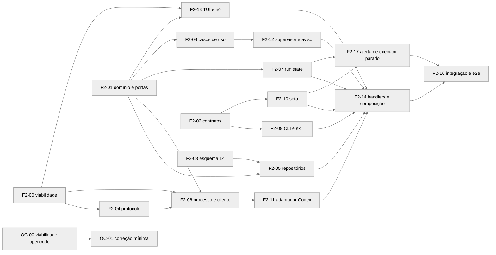

# Partição da fase 2 da orquestração

Cards pequenos para entregar a fase 2 do [ADR da orquestração](ADR-orchestration-executor-service.md), com o Codex como executor. Cada arquivo tem um card dono por onda, e dois cards da mesma onda nunca tocam o mesmo arquivo. Os testes citados por id (U, C, I, E) estão em [Riscos e testes](ORCHESTRATION_RISKS_AND_TESTS.md).

Critério de aceite da fase, vindo do plano: o Claude Code cria dois executores Codex, despacha, recebe um aviso agregado, lê o resultado e encerra, sem clique. Reiniciar o Glimpse no meio não duplica despacho, e executor morto vira aviso de falha.

## Regras de execução

- TDD em todo card, com `pnpm build:cli` antes do vitest quando o card toca CLI ou contratos.
- `pnpm arch:test` em todo card e `pnpm verify:quick` antes de cada commit, conforme o `AGENTS.md`.
- Revisão por agente diferente do autor, com o critério fechado do plano: perda ou duplicação de despacho, autorização furável entre nós, configuração do usuário alterada e teste obrigatório falhando.
- Card que muda contrato atualiza o documento do contrato no mesmo diff.
- Mudança em porta de `application/ports/` depois da onda 1 passa pelo arquiteto antes do diff.
- Nenhum card abre o app de desenvolvimento; o e2e roda pelo Playwright.
- Custo com modelo pago: o V13 do OC-00 e o E-04 foram autorizados pelo Bruno em 09/11/2026, uma rodada de cada.

## Ondas

| Onda | Cards | Começa quando |
| --- | --- | --- |
| 0 | F2-00 e OC-00 | Já, em paralelo; o OC-00 espera a limpeza do opencode na máquina do Bruno |
| 1 | F2-01, F2-02, F2-03 e F2-04 | F2-01 a F2-03 podem começar junto com a onda 0; F2-04 espera F2-00 |
| 2 | F2-05, F2-06, F2-07, F2-08, F2-09 e F2-10 | Dependências de cada card integradas |
| 3 | F2-11, F2-12, F2-13 e F2-17 | Dependências de cada card integradas |
| 4 | F2-14 | Ondas 2 e 3 integradas |
| 5 | F2-16 | F2-14 e F2-17 integrados |
| Trilha OC | OC-01 | OC-00 entregue; cabe na onda 2 ou 3, sem arquivo em comum com elas |

## Onda 0

### F2-00 Viabilidade do Codex

| Campo | Valor |
| --- | --- |
| Objetivo | Responder V1 a V6, V9, V14 e M1 do ADR com o Codex 0.167.0 instalado, sem código de produto |
| Papel | dev-backend |
| Depende de | Nenhum |
| Arquivos donos | `scripts/spikes/executor-service/viabilidade-codex.mjs` (não versionado), `docs/research/orchestration-viability-codex.md`, `docs/research/orchestration-spike-executor-service.md` (o `RESULTADO.md` da prova, movido) e `.gitignore` |

Aceite verificável:

- Cada ponto traz comando, saída observada e veredito entre sim, parcial e negativo.
- Tudo roda com `CODEX_HOME` temporário e a API de respostas falsa de `tests/e2e/agent.prompt.real-codex.helpers.ts`, sem custo de modelo.
- O `sha256sum` de `~/.codex/config.toml` e `~/.codex/hooks.json` sai igual antes e depois.
- Veredito negativo em V1, V4 ou V5 devolve o ADR ao arquiteto antes da onda 3.
- O relatório da prova entra no git em `docs/research/`, e `scripts/spikes/` passa a ser ignorado pelo git.

### OC-00 Viabilidade do opencode v2

| Campo | Valor |
| --- | --- |
| Objetivo | Responder V7, V8, V10, V11, V12 e V13 com o opencode v2 do caminho padrão, chamado como `opencode`, e `OPENCODE_CONFIG_DIR` apontando para uma cópia temporária de `~/.config/opencode` |
| Papel | dev-backend |
| Depende de | Limpeza do ambiente pelo Bruno: só a v2, comando `opencode` e configuração em `~/.config/opencode` |
| Arquivos donos | `scripts/spikes/executor-service/viabilidade-opencode.mjs` (não versionado) e `docs/research/orchestration-viability-opencode.md` |

Aceite verificável:

- Mesmo formato do F2-00 para cada ponto.
- V10 registra o que o comando raiz faz com `--hostname`, `--port` e `--model`, e diz qual forma da correção mínima vale.
- V13 informa tokens de cache write da primeira e da segunda sessão no mesmo diretório, com custo em dólar.
- O hash dos arquivos de `~/.config/opencode` sai igual antes e depois, e um `opencode serve` do usuário, se estiver rodando, segue com o mesmo pid.
- `which -a opencode` mostra um caminho só, e `opencode --version` mostra a v2, como prova da limpeza.

## Onda 1

### F2-01 Domínio e portas

| Campo | Valor |
| --- | --- |
| Objetivo | Criar o domínio puro (ligação, máquina de estados do despacho, rodadas, compositor de aviso e matriz de autorização) e as interfaces das portas |
| Papel | dev-backend |
| Depende de | Nenhum |
| Arquivos donos | `src/contexts/orchestration/domain/agentLink.ts`, `dispatch.ts`, `roundPolicy.ts`, `noticeComposer.ts` e `orchestrationAuthorization.ts`; `src/contexts/orchestration/application/ports/*.ts`; `tests/unit/contexts/orchestration/domain/*.spec.ts` |

Aceite verificável:

- U-01, U-04, U-05 e U-09 verdes em `pnpm exec vitest run tests/unit/contexts/orchestration/domain`.
- O domínio importa só `shared`, e `pnpm arch:test` passa sem aresta nova.
- As portas cobrem a tabela de portas do ADR, sem implementação.

### F2-02 Contratos e DTO da orquestração

| Campo | Valor |
| --- | --- |
| Objetivo | Declarar as doze operações `orch.*`, os erros, os DTOs e o evento `orchestration.links.updated` |
| Papel | dev-backend |
| Depende de | Nenhum |
| Arquivos donos | `src/shared/contracts/controlSurface/operations/domains/orch.ts`, `src/shared/contracts/dto/orchestration.ts`, `src/shared/contracts/controlSurface/operations/registry.ts`, `src/shared/contracts/dto/sync.ts`, `src/shared/contracts/persistedAppState.ts` e os arquivos de `src/shared/sync/` que o campo do espelho de ligações tocar; `tests/contract/controlSurface/orch.contract.spec.ts` e `tests/unit/contexts/controlSurface.operations.spec.ts` |

Aceite verificável:

- C-02 verde.
- `system.operations` lista as doze operações com os escopos da matriz do ADR (interact, read e admin).
- O zod recusa texto acima de 32.768 bytes, caractere de controle fora de tab e quebra de linha, e `dispatchId` fora do formato uuid.
- O DTO de ligação traz `kind`, `state` e `health`.
- `controlSurface.operations.spec.ts` passa a esperar 162 operações `schema` (150 mais as doze `orch.*` da fase 2).
- O estado persistido ganha o campo do espelho de ligações, só para exibição, e a validação e a mesclagem de `src/shared/sync/` o aceitam e deixam o valor do Worker prevalecer.
- `pnpm build:cli` passa.

### F2-03 Esquema SQLite 14

| Campo | Valor |
| --- | --- |
| Objetivo | Subir o esquema para 14 com as quatro tabelas, os índices e a chave `orchestration_links_revision` |
| Papel | dev-backend |
| Depende de | Nenhum |
| Arquivos donos | `src/platform/persistence/sqlite/constants.ts`, `schema.ts` e `migrate.ts`; `tests/contract/platform/persistenceInstalledUpgradeSupport.ts`, `persistenceSchemaColumns.ts` e `persistenceStore.orchestrationSchema.spec.ts` (novo); `docs/architecture/PERSISTENCE.md` |

Aceite verificável:

- C-01 verde, com a matriz de upgrade instalado passando de 1 a 13 para 14.
- Os índices únicos parciais recusam segunda ligação ativa e segundo despacho em voo para o mesmo executor.
- A coluna `spawn_request_id` existe em `agent_links`, e o índice único `(orchestrator_node_id, spawn_request_id)` recusa o segundo spawn com o mesmo `requestId`.
- A segunda abertura do banco deixa tudo igual (reparo idempotente).
- As colunas da fase 3 (`kind`, pedido de conexão e contagem de mensagens) já existem, com padrão neutro para a fase 2.

### F2-04 Subconjunto do protocolo Codex

| Campo | Valor |
| --- | --- |
| Objetivo | Versionar só o pedaço do esquema do Codex que o adaptador usa, com manifesto e teste de contrato |
| Papel | dev-backend |
| Depende de | F2-00 (lista de métodos e campos confirmada, inclusive o eco do V4) |
| Arquivos donos | `scripts/codex-protocol/extract-subset.mjs`; `src/contexts/orchestration/infrastructure/codex/protocol/codex-protocol.subset.json`, `manifest.json` e `codexProtocol.ts`; `tests/fixtures/codex-protocol/*.json`; `tests/contract/orchestration/codexProtocolSubset.spec.ts` e `codexProtocolInstalled.spec.ts` |

Aceite verificável:

- C-03 verde sempre, e C-04 verde com `OPENCOVE_TEST_REAL_CODEX=1` no Codex 0.167.0.
- Um subconjunto adulterado, com um campo lido removido, faz o C-04 falhar com diff legível.
- O manifesto registra versão, métodos e tamanho do subconjunto, com meta abaixo de 300 KB.
- Nada de `scripts/spikes/` entra no diff.

## Onda 2

### F2-05 Repositórios SQLite

| Campo | Valor |
| --- | --- |
| Objetivo | Implementar as portas de persistência sobre as tabelas do esquema 14 |
| Papel | dev-backend |
| Depende de | F2-01 e F2-03 |
| Arquivos donos | `src/contexts/orchestration/infrastructure/persistence/SqliteAgentLinkRepository.ts`, `SqliteDispatchRepository.ts`, `SqliteNoticeOutboxRepository.ts` e `SqliteHookApprovalRepository.ts`; `tests/integration/orchestration/persistence/*.spec.ts` |

Aceite verificável, em SQLite real temporário:

- CAS com `revision` velha devolve conflito sem gravar.
- A reserva está visível para uma segunda conexão quando a chamada retorna (commit antes do envio, D2).
- `dedupe_key` repetida não cria segundo aviso.
- `orchestration_links_revision` sobe na mesma transação da mudança de ligação.

### F2-06 Processo e cliente JSON-RPC do Codex

| Campo | Valor |
| --- | --- |
| Objetivo | Subir e supervisionar o `codex app-server` por executor e falar JSON-RPC com ele |
| Papel | dev-backend |
| Depende de | F2-00, F2-01 e F2-04 |
| Arquivos donos | `src/contexts/orchestration/infrastructure/codex/CodexAppServerProcess.ts`, `CodexJsonRpcClient.ts` e `codexProcessEnv.ts`; `src/contexts/orchestration/infrastructure/process/ExecutorProcessSupervisor.ts`; `tests/unit/contexts/orchestration/codex/CodexAppServerProcess.spec.ts`, `CodexJsonRpcClient.spec.ts` e `tests/unit/contexts/orchestration/process/ExecutorProcessSupervisor.spec.ts`; `tests/integration/orchestration/codexAppServer.real.spec.ts` (opt-in) |

Aceite verificável:

- U-07 e U-08 verdes.
- A linha do `app-server` leva `-c 'projects={"<cwd>"={trust_level="trusted"}}'` (forma de tabela inline, V2) e, para hooks aprovados, `hooks.state={"<key>"={trusted_hash=...}}` (V3); o Worker serializa o início dos serviços (V14) e encerra por SIGKILL no grupo após o prazo (V9).
- Com relógio falso, o supervisor reinicia em 1, 2 e 4 s e para no terceiro reinício dentro de 60 s.
- No teste opt-in com `CODEX_HOME` temporário, `/readyz` responde 200, `initialize` passa e conexão sem token é recusada.

### F2-07 Run state do executor

| Campo | Valor |
| --- | --- |
| Objetivo | Criar a fonte `executor_service` no run state e o ingresso que transforma eventos do executor em estado e arquivo de turnos |
| Papel | dev-backend |
| Depende de | F2-01 |
| Arquivos donos | `src/shared/contracts/dto/terminal.ts`; `src/contexts/agent/domain/agentRunState.ts` e `agentRunStateArbiter.ts`; `src/contexts/agent/application/AgentRunStateRegistry.ts`; `src/app/renderer/shell/utils/agentRunStateArbiterOwner.ts`; `src/app/main/controlSurface/orchestration/executorRunStateIngress.ts`; `docs/agent/RUN_STATE.md`; `tests/unit/contexts/agent/agentRunState.executorService.spec.ts` |

Aceite verificável:

- Início, aprovação e fim levam o registro de trabalhando para aguardando e depois ocioso, com a fonte nova e as invariantes I1 a I3 intactas.
- A mensagem final de até 64 KiB vai ao arquivo, e `agent read --turn` a devolve.
- Renovação a cada 60 s mantém o lease de 180 s, e sem renovação o estado cai como o árbitro define.
- A suíte atual de run state segue verde.

### F2-08 Casos de uso e fila

| Campo | Valor |
| --- | --- |
| Objetivo | Implementar spawn, dispatch, cancel, interrupt, close, extensão, status, aprovações, aprovação de hooks, bomba da fila e reconciliação do boot |
| Papel | dev-backend |
| Depende de | F2-01 |
| Arquivos donos | `src/contexts/orchestration/application/OrchestrationService.ts`, `spawnExecutor.ts`, `dispatchToExecutor.ts`, `dispatchPump.ts`, `reconcileOnBoot.ts`, `linkLifecycle.ts`, `approvals.ts`, `hookApprovals.ts` e `statusView.ts`; `tests/unit/contexts/orchestration/application/*.spec.ts`, exceto os do F2-12 |

Aceite verificável, com repositórios em memória e runtime falso:

- U-02, U-03 e U-09 verdes.
- `orch.spawn` repetido com o mesmo `requestId` devolve a ligação existente com `duplicate:true`, e o despacho inicial usa `dispatchId` uuid v5 derivado do `requestId` (U-02).
- A matriz de reconciliação cobre cada estado em voo contra cada resposta (`found`, `absent` e `unknown`).
- Turno vindo da tela segura a fila, e nunca há dois despachos em voo no mesmo executor.
- A rodada volta em `not_sent` e em `cancelled`.

### F2-09 CLI orch e skill

| Campo | Valor |
| --- | --- |
| Objetivo | Criar o grupo `opencove orch` e a seção de orquestração da skill |
| Papel | dev-backend |
| Depende de | F2-02 |
| Arquivos donos | `src/app/cli/commands/orch.ts`, `src/app/cli/commands/index.ts`, `src/app/cli/skill/SKILL.md`, `tests/unit/app/cliOrch.spec.ts` e `tests/unit/app/__snapshots__/cliInputOutput.spec.ts.snap` |

Aceite verificável, depois de `pnpm build:cli`:

- Ajuda de cada subcomando, com `--text` e `--file` exclusivos.
- Nova tentativa de transporte reaproveita o mesmo `dispatchId`, e o servidor falso conta um aceite só.
- Saídas e códigos de saída iguais às tabelas do ADR.
- Seção da skill com no máximo 30 linhas.

### F2-10 Seta de ligação no canvas

| Campo | Valor |
| --- | --- |
| Objetivo | Desenhar a seta do orquestrador para cada executor ligado, animada enquanto ele trabalha |
| Papel | dev-frontend |
| Depende de | F2-02 |
| Arquivos donos | `src/contexts/workspace/presentation/renderer/components/workspaceCanvas/hooks/useTaskAgentEdges.ts` e `useCanvasViewModel.ts`; `src/app/renderer/shell/hooks/useWorkerSyncStateUpdates.ts`; `src/contexts/orchestration/presentation/renderer/useOrchestrationLinks.ts` e `orchestrationLinksStore.ts`; `src/app/renderer/styles/workspace-canvas.css`; `src/app/renderer/i18n/locales/en.orchestration.ts`, `zh-CN.orchestration.ts`, `en.ts`, `zh-CN.ts` e `schema.ts`; `tests/unit/contexts/workspace/useTaskAgentEdges.links.spec.ts` e `tests/unit/contexts/orchestration/orchestrationLinksStore.spec.ts` |

Aceite verificável:

- U-10 verde.
- A loja lê as ligações do espelho no estado sincronizado e o reaplica no evento e no `resync_required`, com cliente falso; o hook só desenha, e a autorização nunca o consulta.
- O CSS novo usa só valores da paleta já presentes na seta tarefa-agente.
- Nenhuma seta de ligação é selecionável nesta fase.

## Onda 3

### F2-11 Adaptador Codex

| Campo | Valor |
| --- | --- |
| Objetivo | Implementar `ExecutorRuntime` para o Codex, inclusive aprovações e confiança de hooks |
| Papel | dev-backend |
| Depende de | F2-01, F2-04 e F2-06 |
| Arquivos donos | `src/contexts/orchestration/infrastructure/codex/CodexExecutorRuntime.ts`, `CodexExecutorRuntimeFactory.ts`, `codexEventMapping.ts` e `CodexHookTrust.ts`; `tests/unit/contexts/orchestration/codex/CodexExecutorRuntime.spec.ts` e `CodexHookTrust.spec.ts` |

Aceite verificável, com cliente JSON-RPC falso:

- `turn/start` leva `clientUserMessageId` igual ao `dispatchId`, e a mensagem final é o último `agentMessage` do turno.
- A tabela de status do ADR está coberta, e `findTurnByDispatch` devolve `found`, `absent` e `unknown`.
- Aprovação fica pendente até resposta ou `serverRequest/resolved`, e método desconhecido recebe -32601.
- Um espião prova que métodos bloqueados nunca saem.
- Overrides de hook saem por chave, só para pares (`key`, `currentHash`) aprovados.
- `close` chama `thread/archive` antes do SIGTERM, e o encerramento por saída do app não arquiva.
- O sandbox segue a opção de acesso total: desligada, `workspace-write` com `on-request`; ligada, `danger-full-access` com `never`.

### F2-12 Supervisor e aviso

| Campo | Valor |
| --- | --- |
| Objetivo | Transformar eventos em avisos duráveis e entregá-los agregados quando o orquestrador estiver ocioso |
| Papel | dev-backend |
| Depende de | F2-01 e F2-08 |
| Arquivos donos | `src/contexts/orchestration/application/supervisor.ts` e `noticePump.ts`; `src/app/main/controlSurface/orchestration/orchestratorReadiness.ts` e `orchestratorDelivery.ts`; `src/app/main/controlSurface/ptyStream/ptyStreamHub.ts` (marca d'água de entrada); `docs/agent/PROMPT_DELIVERY.md`; `tests/unit/contexts/orchestration/application/supervisor.spec.ts` e `noticePump.spec.ts`; `tests/unit/app/ptyStreamHub.inputWatermark.spec.ts` |

Aceite verificável:

- U-06 verde.
- Aprovação sem resposta gera aviso aos 120 s, uma vez.
- Aviso repetido pela mesma chave é descartado.
- Lote incerto fica sem reenvio e aparece no status como talvez entregue.

### F2-13 TUI do executor e nó ao lado

| Campo | Valor |
| --- | --- |
| Objetivo | Criar o nó executor ao lado do orquestrador, lançar a TUI remota nele sem grant de janela e garantir que reviver o nó passe pela orquestração |
| Papel | dev-backend |
| Depende de | F2-00 (V1 e V2) e F2-01 |
| Arquivos donos | `src/contexts/orchestration/infrastructure/codex/CodexRemoteTuiCommand.ts`; `src/app/main/controlSurface/orchestration/executorTuiLauncher.ts` e `executorNodePlacement.ts`; `src/app/main/controlSurface/handlers/sessionPrepareOrReviveTerminalAgent.ts`; `src/app/main/controlSurface/sessionGrantPtyRuntime.ts`; `tests/unit/contexts/orchestration/codex/CodexRemoteTuiCommand.spec.ts`; `tests/integration/orchestration/executorTui.spec.ts` |

Aceite verificável:

- O comando contém `resume <threadId> --remote ws://127.0.0.1:<porta> --remote-auth-token-env OPENCOVE_EXECUTOR_REMOTE_TOKEN -C <cwd>` sem `-c` de confiança da pasta e sem `CODEX_HOME` próprio na TUI (V2: o portão é do servidor) e sem o texto do token na linha.
- O ambiente da TUI carrega a variável do token, sem `OPENCOVE_CONTROL_TOKEN`, e PTY aninhado herda nenhuma das duas (I-05).
- A remoção das variáveis do token vale só para o ambiente herdado: o lançador injeta `OPENCOVE_EXECUTOR_REMOTE_TOKEN` depois do loop de remoção de `sessionGrantPtyRuntime.ts` (que também filtra o `input.env` do chamador), por campo explícito, e roda fora de `canvasSpawnIdentity`, sem grant (A5).
- `OPENCODE_SERVER_PASSWORD` entra na lista de remoção de `sessionGrantPtyRuntime.ts` neste card, para o OC-01 não disputar o arquivo.
- De 1 a 4 executores ficam à direita do orquestrador sem sobreposição.
- Reviver nó executor passa pelo lançador (espião) e nunca pelo lançamento comum do Codex.

### F2-17 Alerta de executor parado

| Campo | Valor |
| --- | --- |
| Objetivo | Chamar o usuário na hora quando um executor para numa aprovação ou fica indisponível, com repetição opcional |
| Papel | dev-frontend |
| Depende de | F2-07 (espera com motivo `permission` vinda do executor) e F2-10 (loja de ligações com saúde) |
| Arquivos donos | `src/app/renderer/shell/hooks/useAgentStandbyNotificationWatcher.ts`; `src/app/renderer/shell/utils/agentAttentionRouter.ts` e `sidebarAgents.ts`; `src/app/renderer/shell/store/useAgentAttentionStore.ts`; `src/contexts/settings/domain/notificationSettings.ts`, `agentSettings.types.ts` e `agentSettings.defaults.ts`; `src/contexts/settings/presentation/renderer/settingsPanel/NotificationsSection.tsx`; `src/app/renderer/i18n/locales/en.orchestration.ts` e `zh-CN.orchestration.ts` (donos nesta onda); `docs/agent/ATTENTION.md`; `tests/unit/app/executorAttention.spec.ts` |

Aceite verificável:

- U-11 verde.
- Executor ligado em espera com motivo `permission` dispara cartão, notificação do sistema (com o app em segundo plano) e som, uma vez, com o nome do executor e o resumo do pedido; executor `unavailable` dispara o mesmo alerta.
- O clique leva ao nó executor, que aparece como "precisa de você" na barra lateral e no espaço até a pendência acabar.
- Agente comum em espera por permissão segue sem alerta, como hoje, e as suítes atuais de atenção seguem verdes.
- A repetição nasce desligada; ligada, repete no intervalo escolhido enquanto a pendência durar e para quando ela acaba.

## Onda 4

### F2-14 Handlers e composição no Worker

| Campo | Valor |
| --- | --- |
| Objetivo | Expor `orch.*` no Control Surface, compor o contexto no Worker, aplicar a matriz de autorização e fechar o atalho do `agent.prompt` |
| Papel | dev-backend |
| Depende de | F2-02, F2-05, F2-07, F2-08, F2-09, F2-10, F2-11, F2-12 e F2-13 |
| Arquivos donos | `src/app/main/controlSurface/handlers/orchestrationHandlers.ts` e `orchestrationHandlers.support.ts`; `src/app/main/controlSurface/orchestration/composeOrchestration.ts`; `src/app/main/controlSurface/registerControlSurfaceHandlers.ts`; `src/app/main/controlSurface/handlers/agentPromptHandlers.ts` e `sessionInputHandlers.ts`; `docs/architecture/CONTROL_SURFACE.md` e `ARCHITECTURE.md`; `tests/integration/orchestration/authorization.spec.ts` e `nodeDeletion.spec.ts` |

Aceite verificável:

- I-01 e I-07 verdes, com grants reais.
- `agent.prompt` e `session.writeNode` de agente contra executor ligado devolvem `orch.use_dispatch`, e a escrita no PTY não acontece.
- O Worker grava o espelho de ligações no estado sincronizado a cada mudança de ligação e na reconciliação; escrita forjada no espelho via `sync.writeState` não muda o resultado de `orch.dispatch` e some na próxima reconciliação.
- A reconciliação do boot roda antes da bomba.
- O evento `orchestration.links.updated` também sai quando a saúde do executor vai para `unavailable` e quando volta.
- `pnpm arch:test` e `pnpm verify:quick` verdes, inclusive a checagem de sincronia dos documentos de contrato.

## Onda 5

### F2-16 Integração ponta a ponta e e2e real

| Campo | Valor |
| --- | --- |
| Objetivo | Provar o critério da fase com CLIs reais, reinício do Worker no meio do despacho e morte do serviço |
| Papel | test-automation |
| Depende de | F2-14 |
| Arquivos donos | `tests/integration/orchestration/workerRestart.spec.ts`, `serviceDeath.spec.ts`, `noticeOutbox.spec.ts` e `approvals.spec.ts`; `tests/e2e/orchestration.real-codex.spec.ts`, `orchestration.real-codex.helpers.ts` e `orchestration.hooks.real-codex.spec.ts`; `docs/research/orchestration-phase2-cost.md` |

Aceite verificável:

- I-02, I-03, I-04, I-06, E-01, E-02, E-03, E-06 e E-07 verdes.
- E-04 rodado uma vez, autorizado em 09/11/2026, e registrado no documento de custo.
- Falha de teste vira relatório com causa, e o card deixa o código sob teste intocado.

## Trilha OC

### OC-01 Correção mínima do opencode v2 na janela comum

| Campo | Valor |
| --- | --- |
| Objetivo | Fazer a janela comum do opencode funcionar com a v2, preservando o caminho da v1 |
| Papel | dev-backend |
| Depende de | OC-00 (V7, V10 e V12) |
| Arquivos donos | `src/contexts/agent/infrastructure/watchers/OpenCodeSessionApi.ts` e `OpenCodeSessionStateWatcher.ts`; `src/contexts/agent/infrastructure/cli/AgentCommandFactory.ts`; `src/contexts/agent/infrastructure/opencode/OpenCodeServeProcess.ts` (novo, só na forma com serve separado); `src/app/main/controlSurface/handlers/sessionHandlers.ts` e `sessionLaunchAgentInMountHandler.ts`; `src/contexts/agent/presentation/main-ipc/register.ts`; `tests/unit/contexts/agent/opencode/*.spec.ts`; `tests/contract/agent/opencodeV2Api.installed.spec.ts` (opt-in) |

Aceite verificável:

- C-05 e E-05a verdes.
- Resposta HTML vira `incompatible_api` sem exceção solta, e o watcher continua com recuo depois de erro.
- Com a v2 detectada, o cabeçalho Basic vai em toda chamada e a senha fica fora da linha de comando.
- Os testes atuais da v1 seguem verdes sem alteração.

Na máquina do Bruno, o card parte do ambiente limpo: só a v2, chamada como `opencode`, com a configuração em `~/.config/opencode`. Nenhuma variável extra no provedor é necessária.

## Arquivos que mudam de dono entre ondas

| Arquivo | Onda e card |
| --- | --- |
| `src/app/renderer/i18n/locales/en.orchestration.ts` e `zh-CN.orchestration.ts` | Onda 2 com F2-10, depois onda 3 com F2-17 |
| `src/contexts/orchestration/application/ports/*.ts` | Onda 1 com F2-01; mudança posterior só com aval do arquiteto, em onda sem outro dono |

Os demais arquivos têm um dono só em toda a fase.

## Fase 3 em linhas gerais

| Card | Conteúdo |
| --- | --- |
| F3-01 | Adaptador opencode v2 (processo, cliente HTTP com SSE, sessão reutilizada e reconciliação) |
| F3-02 | Conexão por conversa ("conecte com a sessão X") e por arrastar, sempre com clique do usuário, seta selecionável e desligar com confirmação no canvas |
| F3-03 | Aprovação de executor e de hooks pela interface |
| F3-04 | E2E com executores mistos, Codex e opencode no mesmo orquestrador |
| F3-05 | Conversa entre orquestradores, com teto de 5 mensagens por lado e extensão só pelo usuário |

Evoluções sem fase definida: modo yolo, em que o orquestrador aprova pedidos a começar pelos de leitura, e fallback por terminal quando o serviço não sobe.
