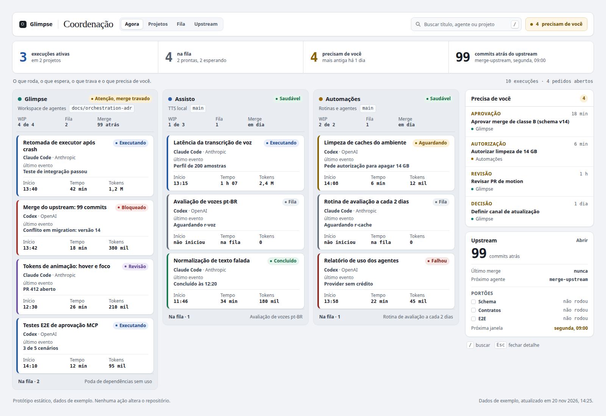

# Mesa de coordenação do Glimpse

Protótipo visual navegável de uma visão única para coordenar projetos, execuções e agentes. A mesa complementa o canvas: mostra o que está rodando, o que espera, o que está travado e o que precisa do Bruno. É um artefato de produto, não código de produção.



## Como abrir

Abra `index.html` direto no navegador, por `file://`. Não há servidor, build, CDN, fonte externa, rede, analytics nem armazenamento local. As fontes são as do sistema.

As visões usam o hash da URL: `#/agora`, `#/projetos`, `#/fila` e `#/upstream`. O botão voltar do navegador funciona.

Atalhos:

| Tecla | Ação |
|---|---|
| `/` | Foca o campo de busca |
| `Esc` | Fecha o painel de detalhe; com o painel fechado, limpa a busca |
| `Enter` ou `Espaço` | Abre o detalhe de um cartão de execução focado |
| `Tab` | Percorre controles e mantém o foco dentro do painel aberto |

## O que cada visão responde

| Visão | Rota | Pergunta |
|---|---|---|
| Agora | `#/agora` | O que roda, o que espera, o que trava e o que precisa de você |
| Projetos | `#/projetos` | Quais projetos estão saudáveis e qual está travado |
| Fila | `#/fila` | O que começa a seguir e o que está esperando o quê |
| Upstream | `#/upstream` | O merge é trabalho do agente, não do Bruno |

A faixa de números é a leitura de dez segundos: 3 execuções ativas, 4 itens no backlog da fila, 4 pedidos abertos para o Bruno e 99 commits atrás do upstream. O número da fila conta o backlog ainda não despachado. Duas execuções aparecem no estado Fila dentro dos projetos porque esperam dependência, e não entram nessa contagem.

Na visão Agora, cada projeto tem uma coluna com cabeçalho e no máximo quatro cartões. Cada cartão traz tarefa, agente e provedor, estado escrito, início, tempo, último evento e tokens. A borda esquerda e a pílula usam a cor do estado, mas o texto do estado é sempre visível.

## Dados de exemplo

Todos os fatos da tela vêm de `data/dados.js`, que define `window.MESA`. O código em `js/app.base.js` (chrome, listas e renderizadores) e `js/app.actions.js` (drawer, ações e eventos) só decide como renderizar, filtrar e responder às ações. Nenhum fato de produto fica no JavaScript da interface.

Estrutura do arquivo:

| Chave | Conteúdo |
|---|---|
| `meta` | Produto, título, atualização, nota de rodapé, atalhos e definição das quatro visões |
| `projetos` | Nome, descrição, cor, branch, WIP, tamanho da fila, estado do merge, saúde e último movimento |
| `execucoes` | Projeto, agente, provedor, título, estado, tempo, evento, tokens, início, custo, texto do que está acontecendo e linha do tempo |
| `fila` | Projeto, título, prioridade, agente sugerido, dependência, estado e detalhe |
| `atencao` | Tipo, pergunta, projeto, idade e alvo (`execucao` ou `projeto`) |
| `upstream` | Commits atrás, último merge, próxima janela, agente, resultado, portões e classes de risco |

Estados válidos nas execuções: `executando`, `aguardando`, `bloqueado`, `revisao`, `concluido`, `fila` e `falhou`.

Prioridades válidas na fila: `alta`, `media` e `baixa`.

Para atualizar a mesa, edite `data/dados.js` e rode o validador. Mantenha os IDs únicos e os alvos de atenção apontando para itens que existem. A linha do tempo de cada execução deve ter de três a quatro eventos. O campo `fila` de cada projeto precisa bater com a quantidade de itens daquele projeto em `fila`.

## Interações

Um clique em um cartão de execução abre um painel de 440px com início, duração, tokens, custo estimado, o que o agente está fazendo, linha do tempo e ações. O fundo fica escurecido e `Esc` fecha o painel.

As ações dependem do estado:

| Estado | Ações |
|---|---|
| Executando | Pausar |
| Aguardando | Aprovar |
| Bloqueado | Aprovar |
| Revisão | Aprovar, Reexecutar |
| Concluído | Reexecutar |
| Falhou | Reexecutar |
| Fila | Despachar |

Toda execução também oferece `Abrir no canvas`. Aprovar um pedido resolve o item correspondente em `Precisa de você` e atualiza os contadores. O estado vive só na memória: recarregar a página volta aos dados de exemplo.

A busca filtra cartões e linhas por título, agente ou projeto nas quatro visões, sem diferenciar acentos. O contador mostra quantos resultados a visão atual encontrou. `Limpar` ou `Esc` devolve a lista completa.

Os botões `Abrir no canvas`, `Despachar` e `Rodar merge agora` não executam nada de verdade. Eles mostram um aviso curto para deixar claro o que aconteceria no app.

## Decisões de design

1. Papel claro (`#f1f3f6`), painéis brancos, linhas finas e tinta escura. Sem neon, glow, glassmorphism ou estética high-tech.
2. Serifada no título e nos títulos do painel, sans na interface e mono nos números e horários.
3. Números grandes na faixa superior, agrupamento visível por projeto e no máximo quatro cartões por coluna.
4. Estado sempre escrito, com cor apenas como reforço. O mesmo vale para saúde do projeto e prioridade da fila.
5. A trilha direita separa o que depende do Bruno do que é trabalho do agente. Upstream tem um cartão próprio porque o merge não é uma tarefa do Bruno.
6. A visão Agora foi medida em 1600x1100 com `scrollHeight` 1100, sem rolagem e sem fonte abaixo de 12px.
7. Foco visível, rótulos ARIA, diálogo modal com contenção de foco e respeito a `prefers-reduced-motion`.
8. O protótipo é desktop primeiro. Há uma quebra responsiva simples para telas menores, mas a referência visual é 1600x1100.

## Validador

```sh
cd docs/knowledge/coordenacao
node validar.mjs
```

O validador não tem dependências. Ele confere:

- IDs únicos entre execuções, fila e atenção.
- Projeto existente e estado válido em toda execução.
- Alvo existente em todo item de atenção.
- Projeto existente e prioridade válida em todo item de fila.
- Dependência existente quando um item da fila está esperando.
- Consistência entre o campo `fila` do projeto e os itens da fila.
- Os três portões do upstream e as três classes de risco.
- Pelo menos uma execução em cada estado principal.
- Ausência de travessão longo (U+2014) e travessão médio (U+2013) em todos os arquivos de texto.
- Linha do tempo com três ou quatro eventos por execução.

A saída lista as contagens e termina com `OK`. Qualquer problema gera uma lista de falhas e código de saída 1.

## Limites conhecidos

- Os dados são de exemplo e não vêm de um runtime real. A mesa não lê o estado do app, do git ou dos agentes.
- As ações são simuladas e não persistem. Não há `localStorage`, servidor ou integração com o canvas.
- A saúde dos projetos é uma leitura ilustrativa do merge e dos pedidos abertos, não um cálculo automático.
- O estado `falhou` foi acrescentado à paleta para cobrir a execução do relatório, que veio assim nos dados de exemplo.
- A busca é local e simples. Ela não usa índice, histórico ou tolerância a erro de digitação.
- A imagem `coordenacao.png` é a captura da visão Agora em 1600x1100, gerada com Playwright.
